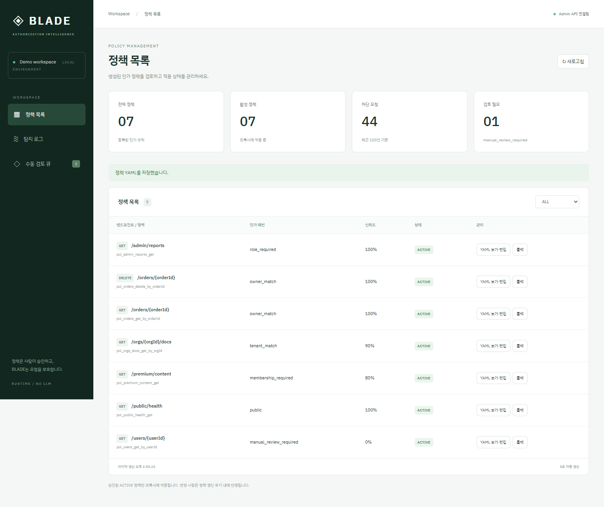

# 대시보드·독립 알림·공격 시뮬레이션 — 2026-09-10

## 범위와 보존

시작 전 기존 회귀 125 passed / 1 skipped를 확인했다.
사용자는 기존 프록시/admin-api 수정 없이 별도 알림 프로세스를 승인했고, Slack 실제 전송 및 화면 증거는 나중으로 미뤘다.
기존 목업은 없으며 새 디자인을 요청했다.

기존 proxy/*.py와 admin_api/*.py를 시작 전 SHA-256과 비교해 변경이 없음을 확인했다.
새 파일 admin_api/alerts.py만 추가했다. [기준 해시](dashboard-baseline-hashes.json).

## 구현

- React/Vite 대시보드, Nginx의 동일 출처 /api 프록시. API/CORS 코드는 변경하지 않았다.
- 정책 상태 필터, 상태에 맞는 승인/거절/롤백, YAML 보기·저장. 서버 409/422 및 잘못된 YAML은 화면에 오류 표시.
- 최근 로그 100건, verdict 필터, 5초 갱신. manual review 정책의 OBSERVE 수도 같은 최근 100건 범위로 명시했다.
- 독립 alerts 컨테이너: read-only admin DB, 별도 영속 커서. 최초 시작은 역사 로그를 전송하지 않는다.
- BLOCK만 Slack text / Discord content로 비동기 전송. 각 호출 최대 5초, 실패 시 URL·본문을 출력하지 않고 로그만 남긴다.
- 전송 실패 이벤트를 재시도하지 않는다. 전송과 커서 저장 사이에 프로세스가 종료되면 재시작 후 중복 전송 가능성이 있다.
- Discord의 2000자 제한 적용, 멘션 파싱 비활성화. 설정이 없는 현재는 외부 전송하지 않는다.

프로토콜 참고: [Slack Incoming Webhooks](https://api.slack.com/messaging/webhooks),
[Discord Webhook](https://docs.discord.com/developers/resources/webhook), [Vite](https://vite.dev/guide/).

## 실제 브라우저·Docker 검증

`scripts/verify_dashboard.py`를 Playwright/Edge로 실행했다.

| 동작 | 프록시 결과 | 반영 시간 |
| --- | --- | --- |
| 대시보드에서 주문 GET 승인 | user_99 → 403 | 2.969초 |
| 대시보드에서 주문 GET 롤백 | user_99 → 200 | 4.609초 |

설정은 5초다. YAML을 열고 저장했으며 탐지 필터와 수동 검토 화면을 조작했다.
브라우저 JavaScript 오류는 없었다. 마지막에 주문 GET을 다시 승인해 현재 ACTIVE로 유지했다.
[브라우저 결과 JSON](dashboard-browser.json).



[탐지 화면](dashboard-detections.png) · [수동 검토 화면](dashboard-review.png) · [모바일 화면](dashboard-mobile.png)

dashboard healthcheck의 localhost IPv6 해석으로 접속 거절이 발생해 127.0.0.1로 수정했다.
정적 빌드는 Vite 7.3.6에서 성공했으며 npm lock 파일을 저장했다.

## 공격 시뮬레이션

`scripts/attack_sim.py --prepare-demo -n 5`를 실제 Docker 프록시/admin-api 대상으로 실행했다.
기존 사용자 정책을 owner_or_admin → manual_review_required로 일시 전환하고 원본을 복원했다.
각 요청 ID로 실제 탐지 로그의 적용 label이 시나리오와 일치하는지도 확인했다.

| 요청 수 | TP | FN | FP | TN | 오류 | 탐지율 | 오탐율 | p50 | p95 |
| ---: | ---: | ---: | ---: | ---: | ---: | ---: | ---: | ---: | ---: |
| 70 | 25 | 5 | 0 | 40 | 0 | 83.3% | 0% | 3.81ms | 4.96ms |

미탐 5건은 manual review가 공격 요청을 OBSERVE로 통과시킨 결과다.
public에는 제한이 없으므로 공격 형태 요청도 정당한 통과(TN)로 계산한다.
5종 강제 정책의 공격은 모두 차단했다. 성능은 단일 로컬 순차 요청의 측정이며 부하 테스트 결과가 아니다.
요청 지연은 HTTP 왕복이며 정책 준비/갱신 대기와 로그 저장 대기를 제외한다.

[전체 14행 결과표](attack-sim-2026-09-10.md) · [요청별 JSON](attack-sim-2026-09-10.json)

## 자동 검증

```text
pytest tests/test_alerts.py tests/test_attack_sim.py -q
3 passed in 0.65s

pytest -q
128 passed, 1 skipped, 2 warnings in 7.02s

Modified existing proxy/admin-api files: []
```

알림 테스트는 로컬 HTTP 서버로 BLOCK 선별, Slack/Discord 본문, 실패 로그 및 커서 재시작을 검증했다.
실제 Slack 채널 도착이나 그 스크린샷을 검증했다고 주장하지 않는다. 해당 항목은 사용자 요청에 따라 제외했다.
