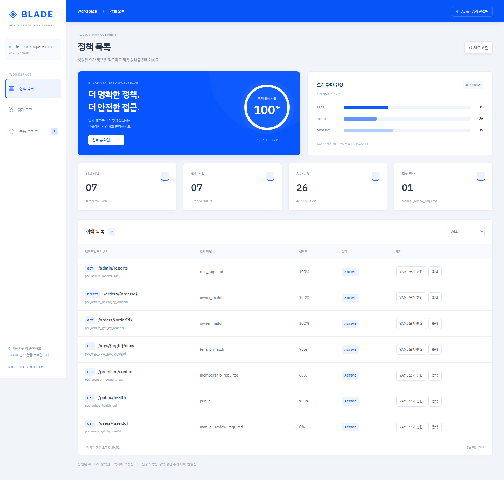

# 대시보드 디자인 변경 — 2026-09-13

## 후속 조정

사용자 피드백에 따라 큰 파란 배너와 원형 지표·분포 그래프를 제거했다.
정책 목록에만 기존 숫자 요약 카드 4개를 남겼다. 수동 검토 큐와 탐지 로그는 제목 다음에 목록을 표시한다.
Docker 빌드 및 브라우저에서 화면별 요약 영역 유무를 확인했다.
[간소화된 수동 검토 큐](dashboard-review-simplified.png).

아래는 최초 파란색 디자인 적용 당시 기록이다.

사용자가 제공한 이미지의 파란색 상단 바, 밝은 배경, 흰색 카드, 슬림한 내비게이션을 반영했다.
기존 세 화면과 API 연동은 유지했다. 백엔드 및 프록시 소스 변경은 없다.

- 파란색 요약 배너, 정책 활성 비율 원형 지표, 최근 탐지 로그의 판단 분포 막대그래프 추가.
- 모든 숫자는 실제 정책과 최근 100건 로그로 계산한다. 활성 비율은 보안 점수가 아니다.
- 데스크톱과 모바일 반응형 레이아웃을 적용했다.
- Docker 대시보드 빌드 및 배포 성공.
- 실제 브라우저에서 정책 7행, BLOCK 필터, 수동 검토 큐, YAML 창 열기를 확인했다.
- 390px 모바일 화면의 가로 넘침 없음 및 JavaScript 오류 없음 확인.
- 이번 디자인 검증에서는 정책 승인/롤백이나 YAML 저장을 실행하지 않았다.

[검증 JSON](blue-dashboard-checks.json) · [모바일 화면](blue-dashboard-mobile.png) · [수동 검토 화면](blue-dashboard-review.png)

